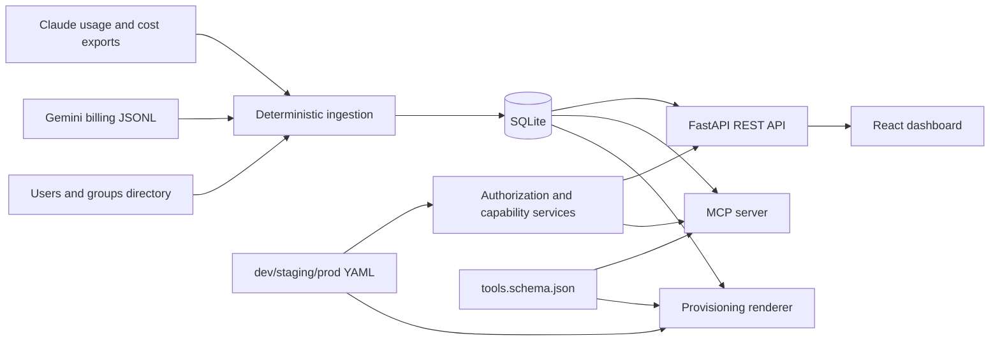

# Meridian AI Platform

Assignment ID: `Fullstack-ClaudeGemini-UsageConnector-v1`

Meridian AI Platform ingests fictional Claude Enterprise Analytics and Gemini billing exports into one normalized usage model, exposes a FastAPI service and React dashboard for platform owners, and provides a scoped MCP connector so authorized assistant users can ask usage and governance questions from inside an assistant.

## Requirement Coverage

See [docs/requirement-coverage.md](docs/requirement-coverage.md) for the requirement-by-requirement matrix.

## Technology Stack

Backend:

- Python
- FastAPI
- Pydantic
- SQLAlchemy
- SQLite
- pytest

Frontend:

- React
- TypeScript
- Vite
- Material UI
- TanStack Query
- Recharts
- Vitest

Connector and provisioning:

- Python MCP SDK
- YAML environment policies
- Deterministic JSON provisioning artifacts
- GitHub Actions CI

## Architecture



The source-of-truth inputs remain under `starter-kit/` and are not modified. Environment YAML files are read at runtime and during provisioning; environment policy is not persisted in SQLite.

## Quick Setup

From the repository root:

```bash
python3 -m pip install -e "backend[test]"
cd frontend
npm install
cd ..
```

Create and ingest the SQLite database:

```bash
python3 -m app.cli bootstrap \
  --db-url sqlite:///backend/meridian.db \
  --starter-kit starter-kit
```

Expected shape:

```text
users=22 groups=6 usage_facts=...
```

## Run the Backend

```bash
MERIDIAN_DATABASE_URL=sqlite:///backend/meridian.db \
MERIDIAN_ENV=dev \
MERIDIAN_STARTER_KIT="$(pwd)/starter-kit" \
uvicorn app.main:app --app-dir backend --reload
```

Open:

- Swagger UI: `http://127.0.0.1:8000/docs`
- Health: `http://127.0.0.1:8000/health`

## Run the Frontend

```bash
cd frontend
VITE_API_BASE_URL=http://127.0.0.1:8000 \
VITE_MERIDIAN_ENV=dev \
npm run dev
```

The frontend uses simulated identities and sends `X-User-Id` to the API. This is for the take-home assignment only; it is not production authentication.

## Environment Configuration

Runtime environment variables:

| Variable | Purpose | Default |
| --- | --- | --- |
| `MERIDIAN_DATABASE_URL` | SQLAlchemy database URL | `sqlite:///backend/meridian.db` |
| `MERIDIAN_ENV` | `dev`, `staging`, or `prod` | `dev` |
| `MERIDIAN_STARTER_KIT` | Path to immutable starter-kit | `starter-kit` |
| `MERIDIAN_MCP_USER_ID` | Simulated MCP startup identity | none |

The assignment data window ends on `2026-09-28`. Relative periods such as `last_7_days` and `last_30_days` are anchored to that date.

## Data Mapping Decisions

Directory:

- `users.json` creates normalized users with role and primary group.
- `groups.json` creates normalized groups with Claude RBAC group IDs and Gemini GCP project IDs.

Claude:

- Claude usage rows are the usage authority.
- Usage is normalized by user, group, date, product, model, token fields, requests, and web search requests.
- Normalized input tokens equal uncached input plus cache read input plus both cache creation categories.
- Source `total_tokens` is preserved and reconciled with calculated totals.
- Claude cost rows do not create usage facts. They attach token and web-search costs to the matching usage grain.
- Claude cost decimal strings are cents and are converted with `Decimal(amount) / Decimal("100")`.

Gemini:

- Gemini rows are billing/token SKU rows.
- `labels.owner` maps to directory users by email.
- `project.id` maps to groups by `gcp_project_id`.
- `project.labels.team` and cost centre are validated against the resolved group.
- input-token SKUs contribute input tokens; output-token SKUs contribute output tokens.
- Gemini request counts are unknown and remain `null`.
- Gemini cost is already USD and is stored using Decimal.

## REST API

Identity is simulated with `X-User-Id` or `X-User-Email`. Unknown identities and conflicting headers fail closed.

Implemented endpoints:

- `GET /health`
- `GET /api/me`
- `GET /api/groups`
- `GET /api/usage/summary?group_id=&period=`
- `GET /api/usage/by-week?group_id=&platform=`
- `GET /api/usage/top-users?group_id=&period=&limit=`
- `GET /api/capabilities?group_id=`
- `PUT /api/capabilities/{group_id}/{capability}`

Example:

```bash
curl "http://127.0.0.1:8000/api/usage/summary?group_id=clinical-operations&period=last_7_days" \
  -H "X-User-Id: user_533B58E6F66C98ACB833527A"
```

## Authorization Model

Authorization is centralized in backend services and reused by REST, MCP, and provisioning.

Concepts:

- Role scope: whether a role may perform `usage:read` or `capabilities:write`.
- Group visibility: whether the caller can see all groups or only their own group.
- Capability state: whether a group-level capability is enabled by YAML default or persisted override.

Environment policy:

| Environment | Usage read | Group visibility | Capability write | Usage connector default |
| --- | --- | --- | --- | --- |
| dev | member, team lead, platform admin | all | team lead, platform admin | enabled |
| staging | team lead, platform admin | own group, admin all | team lead, platform admin | enabled |
| prod | team lead, platform admin | own group, admin all | platform admin | enabled only for IT Platform and Clinical Operations |

Denied responses use this shape:

```json
{
  "error": "permission_denied",
  "reason": "Caller may not access the requested group.",
  "required_scope": "usage:read"
}
```

## MCP Connector

The MCP server exposes exactly four tools from `starter-kit/contracts/tools.schema.json`:

- `usage_summary(group?, period)`
- `top_users(group?, period, limit?)`
- `capability_status(group?)`
- `set_capability(group, capability, enabled)`

Run locally:

```bash
PYTHONPATH=backend \
MERIDIAN_DATABASE_URL=sqlite:///backend/meridian.db \
MERIDIAN_ENV=prod \
MERIDIAN_STARTER_KIT="$(pwd)/starter-kit" \
MERIDIAN_MCP_USER_ID=user_533B58E6F66C98ACB833527A \
python3 -m app.mcp_server
```

Important: `MERIDIAN_MCP_USER_ID` is a trusted simulated local identity for this assignment. A real enterprise deployment would use authenticated connector identity from the assistant host or identity provider.

### Claude Desktop

Claude Desktop supports local MCP servers through desktop extensions. The packaging template is in:

```text
packaging/claude-desktop/
```

Install the MCPB CLI and package:

```bash
npm install -g @anthropic-ai/mcpb
cd packaging/claude-desktop
mcpb pack
```

Then install the resulting `.mcpb` in Claude Desktop Settings > Extensions > Advanced settings > Install Extension. Configure backend path, database URL, starter-kit path, environment, and simulated user ID.

Claude’s current desktop extension flow uses `.mcpb` packages and `manifest.json`; custom extensions can be installed from Claude Desktop settings, and existing local MCP servers can be converted by adding a manifest and packaging with `mcpb pack`.

### Gemini CLI

Gemini CLI extensions are directory packages with a `gemini-extension.json` file. The local extension template is in:

```text
packaging/gemini-cli/meridian-usage/
```

Link it:

```bash
gemini extensions link packaging/gemini-cli/meridian-usage
export MERIDIAN_MCP_USER_ID=user_533B58E6F66C98ACB833527A
gemini
```

Gemini CLI loads extensions from extension directories and supports `mcpServers` entries in `gemini-extension.json`.

## Provisioning

Render and validate all environments:

```bash
python3 -m app.cli provision \
  --actor-user-id user_533B58E6F66C98ACB833527A \
  --db-url sqlite:///backend/meridian.db \
  --starter-kit starter-kit \
  --output-dir provisioning/rendered
```

Generated artifacts:

```text
provisioning/rendered/dev/permissions.manifest.json
provisioning/rendered/dev/host-registration.json
provisioning/rendered/staging/...
provisioning/rendered/prod/...
```

Provisioning is deterministic and safe to rerun. It includes current persisted capability overrides and validates the tool set against `tools.schema.json`.

## Testing

Backend, MCP, provisioning:

```bash
python3 -m pytest backend
```

Frontend:

```bash
cd frontend
npm test
npm run build
```

Full local validation:

```bash
python3 -m pytest backend
cd frontend && npm test && npm run build
```

## CI

GitHub Actions workflow:

```text
.github/workflows/ci.yml
```

It installs backend and frontend dependencies, runs backend/MCP/provisioning tests, bootstraps a CI SQLite database, renders provisioning artifacts, runs frontend tests, and builds the frontend.

## Demo and Team Communication

- Demo walkthrough and transcript template: [docs/demo-walkthrough.md](docs/demo-walkthrough.md)
- Note to team leads: [docs/team-lead-note.md](docs/team-lead-note.md)

## Platform Built and Tested

Built and tested locally on macOS with:

- Python 3.14 locally; CI targets Python 3.12
- Node/npm frontend toolchain
- SQLite
- MCP SDK over stdio
- FastAPI + Vite local servers

## Engineering Standards Followed

- Source-of-truth starter-kit files are immutable.
- Monetary values use Decimal in backend calculations.
- Authorization is enforced server-side.
- Tests cover ingestion mapping, idempotency, authorization boundaries, REST contracts, MCP contracts, provisioning, and frontend state behavior.
- The frontend uses real FastAPI responses and no mock business totals outside tests.
- Provisioning output is deterministic JSON.

Skipped or simplified:

- No Alembic migrations; SQLite schema is created directly for the assignment.
- No Docker or Kubernetes.
- No production identity provider integration.
- MCP packaging is a local demonstration template rather than a fully self-contained enterprise rollout.

## AI Tool Usage

AI coding assistance was used to accelerate implementation, test generation, and final documentation structure. I kept the design intentionally small, reused the existing service boundaries, and overruled suggestions that would have added infrastructure outside the assignment scope, such as Docker, Redis, PostgreSQL, Terraform, or a second authorization engine.

## What I Would Add With More Time

- Alembic migrations and database lifecycle management.
- Real IdP integration and signed connector identity.
- A fully self-contained MCPB bundle with bundled runtime/dependencies.
- Production-grade observability and audit logs for capability changes.
- End-to-end browser automation for the dashboard.
- A recorded demo artifact checked into a release package.

## In The Real Enterprise Version

The directory would come from the identity provider through SCIM or a similar feed, not static JSON. Claude and Gemini usage would come from scheduled platform APIs or billing exports with freshness and backfill guarantees. Connector identity would be issued by the enterprise assistant platform and mapped to users through signed claims, not `MERIDIAN_MCP_USER_ID`.

Capability controls would likely be managed through a central policy service with audit approvals, change tickets, and emergency rollback. Provisioning would publish to organization-level connector registries for Claude and Gemini, with environment-specific manifests promoted through CI/CD. Usage dashboards would run on managed infrastructure, with PostgreSQL or warehouse-backed aggregates, alerting, and data retention controls.

## Known Limitations

- Authentication is simulated for the take-home assignment.
- SQLite is sufficient for the starter-kit dataset but not an enterprise store.
- The Claude Desktop MCPB template expects the backend package and database to be available locally.
- The Gemini extension template is intended for local linking, not a published extension registry.
- The Vite production build emits a large bundle warning; the build succeeds.
